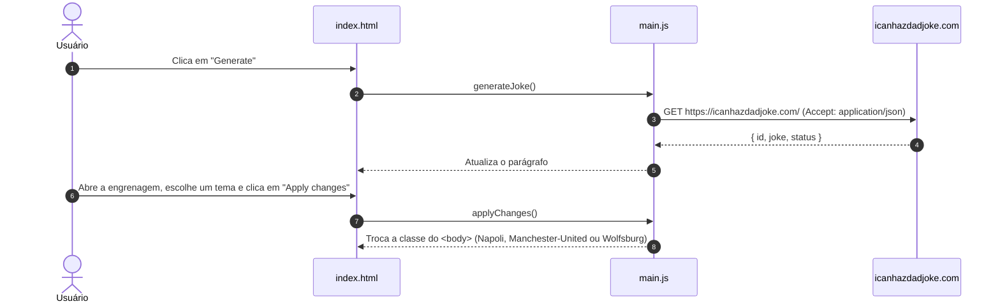
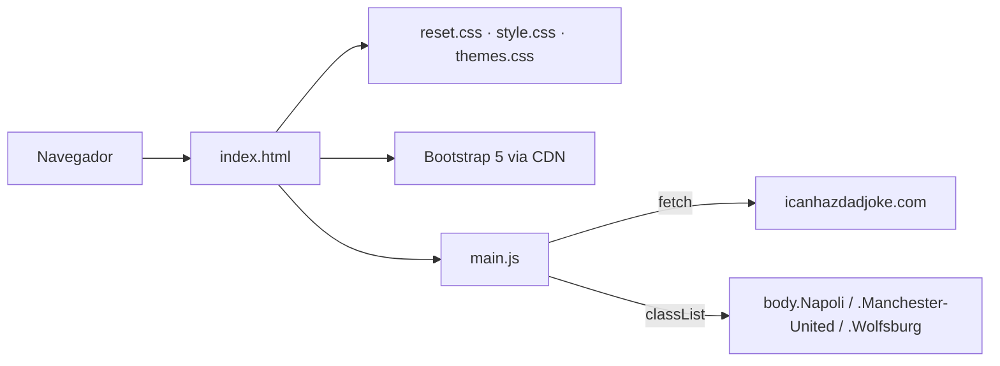

# 😂 Joke Generator — Gerador de Piadas Aleatórias


> Uma piada nova a cada clique, com temas inspirados em clubes de futebol.

O **Joke Generator Web** é um site estático feito com **HTML, CSS e JavaScript puro** que busca piadas aleatórias na API pública [icanhazdadjoke](https://icanhazdadjoke.com/) e as exibe num card central. A interface usa **Bootstrap 5** (via CDN) para o menu de configurações, onde o usuário escolhe entre três temas de cores. O projeto está publicado no GitHub Pages: **[matheusnascimentods.github.io/joke-generator-web](https://matheusnascimentods.github.io/joke-generator-web/)**.



---

## ✨ O Problema
- **Exemplo prático de consumo de API**: um projeto pequeno e direto para exercitar `fetch`, `async/await` e manipulação do DOM sem frameworks.
- **Conteúdo sempre novo**: uma piada fixa no HTML perde a graça rápido; o conteúdo precisa vir de uma fonte externa.

---

## 🚀 A Solução
- **Piadas aleatórias**: o botão **Generate** consulta a API e substitui o texto do card por uma piada nova.
- **Temas de cores**: o menu da engrenagem oferece três temas (Napoli, Manchester United e Wolfsburg), aplicados ao fundo da página e aos botões.
- **Layout adaptável**: o card ocupa 90% da largura até o limite de 350px, funcionando em desktop e celular.

---

## 🎯 Diferenciais
- **Sem build e sem dependências locais**: basta abrir o `index.html`; o Bootstrap e a fonte Poppins vêm de CDN.
- **Temas só com CSS**: cada tema é uma classe no `<body>` que usa as variáveis `--napoli-color`, `--manchester-color` e `--wolfsburg-color` definidas em `reset.css`.
- **Integridade dos scripts de CDN**: o Bootstrap é carregado com `integrity` (SRI) e `crossorigin`.

---

## 🛠️ Stack Tecnológica

| Camada | Tecnologia |
|---|---|
| **Estrutura** | HTML5 |
| **Estilos** | CSS3 (variáveis CSS) + fonte Poppins (Google Fonts) |
| **Componentes de UI** | Bootstrap 5.3.0-alpha3 via jsDelivr (dropdown e radio buttons) |
| **Lógica** | JavaScript puro (`fetch` + `async/await`) |
| **API de piadas** | [icanhazdadjoke](https://icanhazdadjoke.com/api) |
| **Hospedagem** | GitHub Pages |

---

## 🏛️ Arquitetura

Página única, sem roteamento nem backend: o navegador carrega o HTML, os estilos e o `main.js`, que chama a API diretamente.



---

## 🗺️ Telas & Rotas

| Rota | Tela | O que entrega |
| :--- | :--- | :--- |
| `/` (`index.html`) | Gerador | Card com a piada atual, botão **Generate** e menu de temas na engrenagem |

### Capturas de tela


<table>
  <tr>
    <td align="center" width="33%"><br/><sub>Desktop</sub></td>
    <td align="center" width="33%"><br/><sub>Desktop</sub></td>
    <td align="center" width="33%"><br/><sub>Desktop</sub></td>
  </tr>
  <tr>
    <td align="center" width="33%"><br/><sub>Mobile</sub></td>
    <td align="center" width="33%"><br/><sub>Mobile</sub></td>
    <td align="center" width="33%"><br/><sub>Mobile</sub></td>
  </tr>
</table>

---

## 📁 Estrutura do Projeto

```text
joke-generator-web/
├── assets/
│   ├── css/
│   │   ├── reset.css            # Reset de estilos e variáveis de cor dos temas
│   │   ├── style.css            # Layout da página e do card
│   │   └── themes.css           # Classes dos temas (Napoli, Manchester-United, Wolfsburg)
│   ├── images/
│   │   └── gear.svg             # Ícone do menu de configurações
│   └── js/
│       └── main.js              # Busca de piadas e troca de tema
├── Screenshots for Github/      # Capturas de tela (desktop e mobile)
├── image.jpeg                   # Imagem de prévia
├── index.html                   # Página única
└── LICENSE.txt
```

---

## ⚡ Quick Start

### Pré-requisitos
- Um navegador moderno com acesso à internet (a API e o Bootstrap são carregados online)

### 1. Clonar o repositório
```bash
git clone https://github.com/matheusnascimentods/joke-generator-web.git
cd joke-generator-web
```

### 2. Abrir a página
Abra o `index.html` no navegador, ou sirva a pasta com um servidor estático:

```bash
python3 -m http.server 8000
```

A aplicação estará disponível em: **`http://localhost:8000`**

Versão publicada: **[matheusnascimentods.github.io/joke-generator-web](https://matheusnascimentods.github.io/joke-generator-web/)**

---

## 💻 Comandos Úteis

O projeto não tem `package.json`, build, testes nem lint. O único comando útil é o servidor estático acima.

---

## 🔌 API Reference (Recursos Consumidos)

| Método | Rota | Uso na interface | Tela |
| :--- | :--- | :--- | :--- |
| `GET` | `https://icanhazdadjoke.com/` (header `Accept: application/json`) | Piada aleatória; o campo `joke` substitui o texto do card | Gerador |

A API é pública e não exige chave. Documentação: [icanhazdadjoke.com/api](https://icanhazdadjoke.com/api).

---

## 🔒 Segurança & Boas Práticas

- **Sem segredos**: não há chaves de API nem variáveis de ambiente; a API usada é pública.
- **SRI no Bootstrap**: CSS e JS do Bootstrap são carregados com hash `integrity`.
- **Limitações conhecidas**:
  - A piada é inserida com `innerHTML`; `textContent` seria mais seguro, já que o conteúdo vem de uma fonte externa.
  - Falhas na requisição só aparecem no console; a interface não mostra mensagem de erro.
  - O tema escolhido não é salvo e volta para Napoli ao recarregar a página.
  - O Bootstrap usado é uma versão alpha (`5.3.0-alpha3`).

---

## 🤝 Contribuindo

1. Faça um Fork do projeto
2. Crie uma branch para a sua funcionalidade (`git checkout -b feature/nome-da-feature`)
3. Teste as alterações abrindo o `index.html` no navegador
4. Faça o commit das suas alterações (`git commit -m 'feat: implementa nova funcionalidade'`)
5. Envie para o repositório remoto (`git push origin feature/nome-da-feature`)
6. Abra um **Pull Request** detalhando as alterações

---

## 📄 Licença

Distribuído sob a licença MIT. Veja [`LICENSE.txt`](LICENSE.txt) para mais detalhes.

---
Feito com ❤️ por [@matheusnascimentods](https://github.com/matheusnascimentods)
